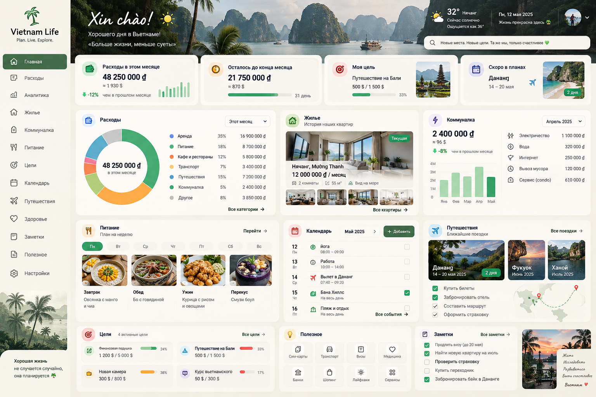
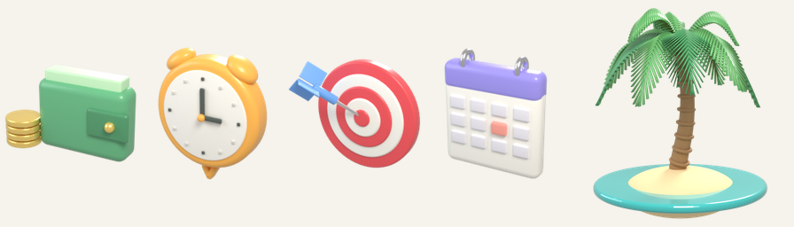

# Vietnam Life

Планер жизни во Вьетнаме: расходы, аналитика, жильё, коммуналка, питание, цели, календарь, путешествия, здоровье и заметки — всё на одной панели.

**Сайт:** https://t0niske.github.io/vietnam-life/



## Что внутри

- `index.html` — собранная страница (стили и скрипты встроены, картинки лежат в `img/`).
- `style.css`, `app.js`, `demo.js` — исходники интерфейса и демо-данные.
- `seed/` — примеры данных в JSON.
- `img/` — фотографии и 3D-иконки.
- `build.py` — собирает `index.html` из исходников.

Без входа данные хранятся в `localStorage` браузера (при первом запуске подставляются демо-данные).
После входа по почте (Настройки → «Вход и синхронизация») данные хранятся в Supabase и общие для всех участников.

## Облако и Telegram-бот

- **Supabase** (`supabase/`): таблица `vl_sections` — по строке на раздел сайта; читать и писать могут только адреса из `vl_members` (RLS), регистрация закрыта для остальных.
- **Бот [@vietnam_helpbot](https://t.me/vietnam_helpbot)** (`supabase/functions/telegram-bot`): принимает голосовые и текст, распознаёт речь (Groq Whisper или OpenAI), разбирает сообщение через Claude и добавляет расходы, события, заметки и записи о здоровье. Под каждым ответом есть кнопка «Отменить».
- Подключение бота: на сайте Настройки → «Подключить Telegram» → открыть ссылку и нажать Start.
- Ключи (токен бота, Anthropic, Groq/OpenAI) хранятся в Supabase Vault, в репозитории их нет.

## Графика

- **Фотографии** (шапка с бухтой Халонг, квартиры, еда, поездки, боковые панели) сгенерированы через Codex (GPT image).
- **3D-логотип с пальмой и иконки карточек** (кошелёк, будильник, мишень, календарь) смоделированы и отрендерены в Blender (Cycles).



## Сборка и запуск

```bash
python build.py
python -m http.server 8000
```

Затем откройте http://localhost:8000.
